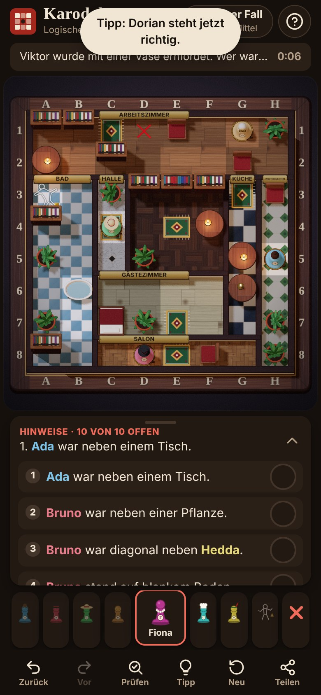

# Karodoku

Generierte Mordrätsel in einem hölzernen 3D-Puppenhaus – optimiert fürs Handy, spielbar im Browser
und offline als App (PWA).



## Spielregeln

- In jeder **Zeile** und jeder **Spalte** steht genau **eine Person** – das Opfer zählt mit.
- Personen stehen auf freiem Boden, Stühlen, Betten, Teppichen oder in der Badewanne –
  nie auf Tischen, Pflanzen oder Regalen.
- Der Täter oder die Täterin war **allein mit dem Opfer** im selben Raum.
- Jeder Fall hat genau eine Lösung und ist ohne Raten lösbar.

## Funktionen

- **Rätselgenerator** im Web Worker, deterministisch aus einem Seed (teilbarer Link
  `?n=8&d=hard&s=abc123`), Tagesfall (Seed = Datum), Größen 5×5 bis 8×8, drei Schwierigkeitsgrade.
- **Garantierte Qualität:** Ein Backtracking-Löser prüft, dass es genau eine Lösung gibt; die Hinweise
  werden auf eine minimale Menge reduziert. Ein zweiter, „menschlicher“ Löser bewertet die Schwierigkeit:
  *Leicht* braucht nur direkte Schlüsse, *Mittel* höchstens drei Was-wäre-wenn-Runden, *Schwer* mehr.
- **3D-Puppenhaus** (Three.js): Holzbox mit eingebrannten Koordinaten, Böden je Raumtyp (Fischgrät,
  Dielen, Karo-Fliesen, Steinplatten, Marmor …), niedrige Wände auf den Raumgrenzen, Messingschilder,
  prozedural modellierte Möbel und Spielfiguren mit je einem Erkennungsmerkmal, Kreide-Umriss für das Opfer,
  Mondlicht mit Schatten und flackernde Kerzen.
- **Animationen:** Kamera-Fahrt zum Start, hüpfende Figuren mit Staubwolke, wackelnde Möbel, beim Lösen
  Spotlicht, roter Faden und Stempel „Fall gelöst“. Alles entfällt bei „Bewegung reduzieren“.
- **Handy-Bedienung:** Person wählen, Feld antippen; lange drücken setzt ein ✕. Hinweis-Leiste mit
  Wischgesten (hoch = öffnen, seitlich = blättern und Personen/Räume hervorheben), Hinweise abhaken mit
  Stempel „Geprüft“, Möbel-Legende, Zurück/Vor, Prüfen, Tipp, Teilen mit Emoji-Grundriss.
- **2D-Ansicht** als leichte SVG-Alternative: automatisch ohne WebGL oder bei langsamer 3D-Darstellung,
  jederzeit umschaltbar. Beim ersten Laden ist das 2D-Brett sofort spielbar, die 3D-Szene blendet ein,
  sobald sie fertig ist.
- **Barrierefreiheit:** unsichtbares, synchrones Tastatur-/Screenreader-Raster (Pfeiltasten, Enter,
  Leertaste für ✕, Ziffern für Personen, X für Notizen, Strg/⌘+Z bzw. ⇧ für Rückgängig/Wiederholen).
- **Deutsch und Englisch**, heller und dunkler Modus (die 3D-Szene ist immer Nacht), Vibration,
  optionale Holz-Klack-Töne (aus Standard aus), Fortschritt im Browser gespeichert.
- **PWA:** installierbar, offline spielbar, Hinweis bei neuer Version.

## Struktur

| Pfad | Inhalt |
| --- | --- |
| `src/core/` | Zufallsgenerator, Datenmodell, Hinweise, Generator, Löser (rein, ohne DOM, getestet) |
| `src/i18n/` | Texte und Hinweis-Formulierungen DE/EN |
| `src/state/` | Spielzustand mit Rückgängig/Wiederholen, versionierte Speicherung (`karodoku2:`) |
| `src/worker/` | Rätsel-Erzeugung im Web Worker |
| `src/render3d/` | Szene, Kamera, Render-Schleife, Texturen, Möbel, Figuren, Partikel |
| `src/render2d/` | SVG-Brett |
| `src/ui/` | Oberfläche, Dialoge, Eingabe, Haptik/Töne, PWA |
| `tests/` | Vitest: Eindeutigkeit, Regeln, Minimalität, Schwierigkeit, Determinismus, Laufzeit |
| `scripts/` | Screenshots, Leistungsmessung, Offline-Test, Icons und Legenden-Bilder backen |
| `screenshots/` | Aktuelle Bilder (Handy 390×844, Desktop 1280×800, 5×5/8×8, hell/dunkel) |
| `lineup.html` | Entwicklerseite mit allen Modellen (nicht im Build) |

## Entwicklung

```sh
npm install
npm run dev          # Entwicklungsserver (http://localhost:5173, Modelle unter /lineup.html)
npm test             # Vitest (KARODOKU_SEEDS=40 npm test für mehr Seeds)
npm run typecheck
npm run build        # Typecheck + Produktions-Build nach dist/
npx tsx scripts/stats.ts 20                       # Generator-Statistik
node scripts/screens.cjs http://localhost:5173/ screenshots   # Screenshot-Matrix
node scripts/bake-thumbs.cjs                      # Legenden-Bilder neu backen (Dev-Server läuft)
```

## Messwerte

Gemessen in Chromium (headless) mit gedrosseltem 4G (1,6 Mbit/s, 150 ms RTT) und 4× langsamerer CPU:

| | |
| --- | --- |
| Übertragung beim ersten Laden | ca. 190 KB (gzip, inkl. Three.js) |
| Erste Interaktion | ca. 1,0 s |
| Rätsel 8×8 schwer (Web Worker) | 40–210 ms |
| Generator in Node, 8×8 alle Stufen | Ø 30–180 ms, max. ca. 0,6 s |
| axe-core | keine Verstöße (hell/dunkel, Handy/Desktop, Dialoge) |

Die 60-FPS-Werte lassen sich headless nur mit Software-Rendering messen und sind dort nicht aussagekräftig;
auf echten Geräten zeichnet die Szene nur während Animationen. Fällt die Bildrate in den ersten Sekunden
unter 30 FPS, bietet das Spiel den Wechsel auf 2D an.

## Deployment

Die Seite wird per GitHub Actions gebaut und veröffentlicht (`.github/workflows/deploy.yml`):
Typecheck, Tests, Vite-Build mit dem Pages-Basispfad, Upload auf GitHub Pages – bei jedem Push auf `main`.

Einmalig nötig: unter **Settings → Pages → Source** „GitHub Actions“ auswählen. Die frühere
Veröffentlichung direkt aus dem Branch (mit `.nojekyll`) entfällt, weil die Seite jetzt gebaut werden muss.
